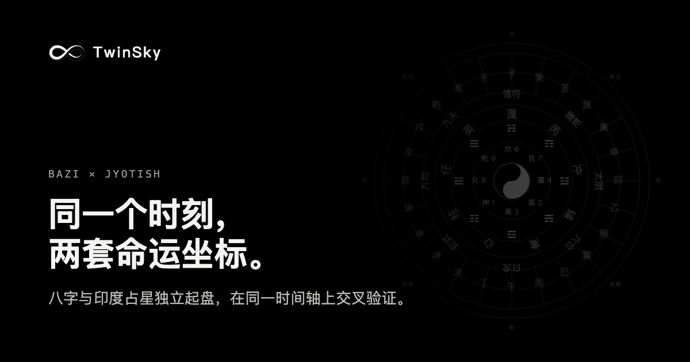
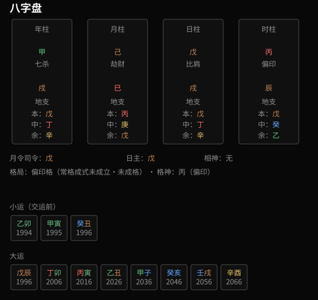

<p align="center">
  <a href="https://twinsky-ai.com/?utm_source=github&utm_medium=readme&utm_campaign=engine"></a>
</p>

<p align="center">
  <a href="https://twinsky-ai.com/?utm_source=github&utm_medium=readme&utm_campaign=engine"></a>
  <a href="https://github.com/lllgjskdk/twinsky-engine/actions/workflows/tests.yml"></a>
  <a href="LICENSE"></a>
</p>

# TwinSky Engine

**BaZi (Four Pillars) charts, 36-point Ashtakoota matching and a NASA JPL ephemeris for Python. MIT-licensed, no Swiss Ephemeris.**

> **Want the reading, not just the numbers?** [TwinSky](https://twinsky-ai.com/?utm_source=github&utm_medium=readme&utm_campaign=engine) casts your BaZi and Jyotish (Vedic) charts side by side for free, then lets you ask an AI about your career, relationships and timing, with every answer pointing back to your chart. This engine is the open part of it.

[中文说明](README.zh-CN.md) · [Accuracy](docs/ACCURACY.md) · [Get your free chart on TwinSky](https://twinsky-ai.com/?utm_source=github&utm_medium=readme&utm_campaign=engine)

<p align="center"></p>

```python
from twinsky_engine import birth, bazi_chart, ashtakoota, render_bazi_chart

me = birth("1994-05-12T09:30", lat=1.29, lng=103.85, gender="female", timezone="Asia/Singapore")
chart = bazi_chart(me)
chart.pillars        # {'year': '甲戌', 'month': '己巳', 'day': '戊戌', 'hour': '丙辰'}
chart.day_master     # '戊'
chart.da_yun[0]      # first luck pillar, with its start and end years
svg = render_bazi_chart(chart)   # the picture above (examples/sample_chart.py)

him = birth("1985-12-01T23:40", lat=40.71, lng=-74.01, gender="male", timezone="America/New_York")
ashtakoota(him, me, groom_timezone="America/New_York", bride_timezone="Asia/Singapore")["total"]   # 27.0 of 36
```

## What's inside

| Module | What it does |
|---|---|
| BaZi 八字 | Four pillars with month boundaries at the exact solar terms; hidden stems, Ten Gods, 司令; luck pillars 大运 with their start age, annual 流年 and minor 小运 pillars; month and day calendars |
| True solar time | Longitude correction (default), standard time, or longitude plus the equation of time; IANA time zones with historical daylight saving |
| Ashtakoota | 36-point Guna Milan from the two natal Moons (True Chitra ayanamsa): Varna, Vashya, Tara, Yoni, Graha Maitri, Gana, Bhakoot, Nadi |
| Chart drawings | SVG for the BaZi chart and its details |
| `twinsky_engine.ephemeris` | A pyswisseph-compatible subset (`calc_ut`, `julday`, `set_sid_mode`, `houses_ex`, `rise_trans`, `get_ayanamsa_ut`, …) on Skyfield + NASA JPL DE440, usable on its own |

## What TwinSky adds on top

The engine gives you the chart. [TwinSky](https://twinsky-ai.com/?utm_source=github&utm_medium=readme&utm_campaign=engine) is the product built on it:

- **Two systems for one question**: BaZi for the overall pattern, Jyotish with its divisional charts and dashas for the specific area you ask about.
- **Answers you can check**: the AI reads the computed chart, and every claim links to the pillar, house or period it comes from.
- **Free to start**: charts, the daily outlook, day picking and guides are free; asking the AI uses points, with free points on sign-up.
- Five languages: English, 简体中文, 繁體中文, 日本語, 한국어.

**[Cast your free chart →](https://twinsky-ai.com/?utm_source=github&utm_medium=readme&utm_campaign=engine)**

## Install

```bash
pip install git+https://github.com/lllgjskdk/twinsky-engine
python -m twinsky_engine.fetch    # once, for the Moon and the ephemeris: the DE440 excerpt (about 80 MB) into ~/.twinsky-engine
```

BaZi needs no download. Set `TWINSKY_EPHE_PATH` to keep the ephemeris elsewhere.

## Command line

```bash
python -m twinsky_engine 1994-05-12T09:30 --lat 1.29 --lng 103.85 --gender female --summary
python -m twinsky_engine 1985-12-01T23:40 --lat 40.71 --lng -74.01 --gender male \
    --match 1994-05-12T09:30 --match-lat 1.29 --match-lng 103.85
```

The time zone is looked up from the coordinates when `--timezone` is omitted.

## Why

| | License | Ephemeris |
|---|---|---|
| **TwinSky Engine** | MIT | JPL DE440 (public data) via Skyfield (MIT) |
| Libraries built on Swiss Ephemeris | AGPL-3.0 or a paid Swiss Ephemeris license | Swiss Ephemeris |

You can use it in closed-source and commercial products. After the one-time ephemeris download nothing calls a network service.

## Tests

```bash
pip install -e .[test]
python -m twinsky_engine.fetch
pytest
```

`tests/golden.json` holds results the TwinSky app gave for four fictional births: BaZi digests, natal Moon longitudes and two Ashtakoota scores. The tests recompute them here.

## Credits

- [lunar-python](https://github.com/6tail/lunar-python) by 6tail (MIT) for the Chinese calendar.
- [Skyfield](https://rhodesmill.org/skyfield/) and [jplephem](https://github.com/brandon-rhodes/python-jplephem) by Brandon Rhodes (MIT); NASA JPL's DE440 ephemeris.
- Three table modules of [dashaflow](https://github.com/adarshj322/dashaflow) by Adarsh J (MIT), see `src/twinsky_engine/_vendor/dashaflow/NOTICE.md`.

See [THIRD_PARTY_NOTICES.md](THIRD_PARTY_NOTICES.md).

## A note on use

BaZi and Ashtakoota are traditional systems of interpretation. The engine computes them carefully; it does not make predictions true. Please don't use it for medical, legal or financial decisions.

## License

MIT, © 2026 Dreamie Tech Limited. See [LICENSE](LICENSE). Made by the team behind [TwinSky](https://twinsky-ai.com/?utm_source=github&utm_medium=readme&utm_campaign=engine).
